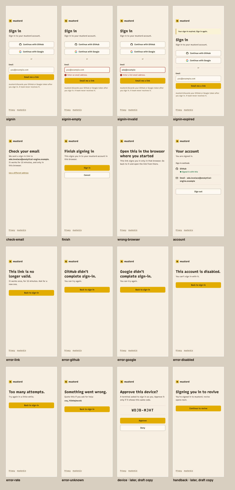
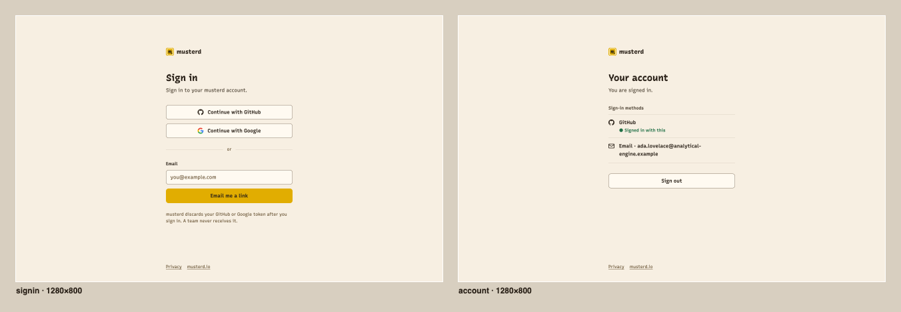

# Console sign-in — the screens at app.musterd.io

- Status: design for build, 2026-10-15. slippy (designer) owns layout; alfie owns the words; fifty builds.
- Lanes: design `01M51E8397H4XZJ242ZK2RCW7N`; build `01M3Z43QYBT47XAPJGC5B2EZMS`; copy `01M51E51TZCAHQ0SWRF20BBYQD`.
- Derives from: [ADR 620](../../decisions/620-console-sign-in.md) (the flows), [ADR 615](../../decisions/615-console-skeleton.md) (the HTTP boundary),
  [ADR 037](../../decisions/037-web-surface-aesthetic.md) (product chrome stays minimal), `docs/design/brand.md` §1–§3, `PRODUCT.md`,
  and the copy spec [`console-signin-copy-spec.md`](../../design/console-signin-copy-spec.md).
- Reference build: [`docs/design/console/`](../../design/console/) — one stylesheet and one HTML file per state. Lift them;
  they are the spec in its most exact form.





## What the console looks like, and why

The console is product chrome, not the site (ADR 037). It is the musterd paper: the same warm palette
`/live` and musterd.io use, the mustard accent once per screen, Recursive in its three cuts. It is
light only, as `/live` is — the product has no dark theme, and the site's dusk palette is cool where
the product is warm (PRODUCT.md, principle 1).

Every screen is one narrow column on the paper, no card around it: the lockup, a heading, a line,
the controls, a footer. A sign-in page is the place for earned familiarity (PRODUCT.md, principle 4),
so its structure is the one people already know. The one chosen detail carries meaning: on Your
account, the sign-in method this session used wears the CLI's roll-call presence dot (brand.md §2)
beside its words. (The words are pending alfie; without them the marker comes off.)

## Delivery under the CSP

ADR 615 serves `default-src 'none'`. The pages need exactly this, and nothing inline:

```
default-src 'none'; style-src 'self'; font-src 'self'; img-src 'self'; form-action 'self';
frame-ancestors 'none'; base-uri 'none'
```

- **No script.** Nothing on these screens needs it. Focus on an error is `autofocus` on the field.
- **No inline style.** Every state is a class in `console.css`. Inline `<svg>` with presentation
  attributes is fine (it is markup, not a resource).
- **Self-hosted fonts**: the three committed cuts in `packages/web/src/styles/fonts/` (OFL), served from
  the console origin at `/fonts/`. A face downloads only when text uses it: sign-in fetches linear
  and casual (≈ 98 KB woff2, cached immutable); mono (≈ 45 KB) loads only on the code and
  request-id pages.
- **Icons**: GitHub mark and mail are Octicons (MIT, one set, one stroke); Google's "G" is Google's
  own four-colour mark, which its brand rules require unaltered. No icon font, no third-party request.
- **Favicon**: the small-cut mark (`docs/design/console/favicon.svg`).
- Measured on the reference build in headless Chrome with this CSP: no violations on any page.

## Layout

| | 390 × 844 (phone) | 1280 × 800 and up |
| --- | --- | --- |
| Column | full width, 20 px gutters (16 px under 360 px) | 380 px, centred |
| Top of page | `clamp(32px, 12vh, 128px)` above the lockup | same |
| Footer | pinned to the bottom of the viewport, or below content when it is taller | same |

From the top: lockup (24 px mark + "musterd" in display 700 18/24) → 48 px → notice (only on
`signin-expired`) → heading → 8 px → lede → 32 px → the controls → the note (sign-in only) → footer.
At 320 px the column is 280 px and nothing scrolls sideways (WCAG 1.4.10).

## Tokens

Defined by role at the top of `console.css`. Values come from `tokens.css` (paper) and brand.md.

| Token | Value | Role | Contrast (on ground / on field) |
| --- | --- | --- | --- |
| `--c-ground` | `#f7efe2` | page | |
| `--c-field` | `#fffaf1` | button and input fill | |
| `--c-text` | `#2a2118` | headings, body, labels | 13.8 / 15.2 |
| `--c-text-dim` | `#4a3f30` | ledes, section labels | 9.0 / 9.9 |
| `--c-text-faint` | `#6b5637` | the note, the footer, placeholders | 6.1 / 6.7 |
| `--c-edge` | `#8c7e6d` | control borders | 3.46 / 3.8 (≥ 3, WCAG 1.4.11) |
| `--c-rule` | `rgba(60,40,20,.14)` | dividers only — never a control edge | decorative |
| `--c-accent` | `#e1ad01` | primary button fill | — |
| `--c-on-accent` | `#2a2118` | primary button text | 7.7 on mustard-500, 9.9 on mustard-300 (hover) |
| `--c-accent-ink` | `#7a5a12` | links | 5.6 / 6.1 |
| `--c-danger-ink` | `#a3241b` | field error text, error border | 6.5 / 7.2 |
| `--c-success-ink` | `#1f6f45` | the session marker | 5.4 / 5.9 |
| `--c-focus` | `#2a2118` | 2 px focus ring, 3 px offset (1 px on inputs) | 13.8 |

The first pass used an alpha edge for borders; it measured 2.38:1 and failed 1.4.11, which is why
`--c-edge` is opaque.

Type is brand.md §3: h1 Casual 700 28/36; body 15/24; small 13/20; label 600 13/20; buttons 600 15/20;
code Mono 600 28/36 with 0.08em tracking; the request id Mono 600 14/22. Space is one scale
(4, 8, 12, 16, 24, 32, 48). Controls are 44 px tall, 8 px radius.

## Controls

- **Primary button** (mustard fill): the one action each screen exists for — Email me a link, Sign
  in, Back to sign-in, Approve. One per screen.
- **Secondary button** (field fill, edge border): Continue with GitHub / Google, Cancel, Sign out,
  Deny.
- **Text link** (accent ink, underlined): Use a different address; the footer. At least 24 px tall.
- A provider "button" is an `<a>` to the console's own start route; the email submit, Sign in on
  `finish`, Sign out, and Approve/Deny are `<button>`s in `method="post"` forms (ADR 620 decisions 6–8:
  every change is a POST carrying the CSRF field the build adds; a GET never changes state).
- Hover darkens the border (secondary) or lightens the fill to mustard-300 (primary), 120 ms
  ease-out, colour only. Reduced motion removes the transition. Nothing else moves.

## The screens

Strings are in the copy spec, character for character; this table is which string goes in which
slot. `{address}` and `{request_id}` are server-filled.

| File | Copy spec | Notes |
| --- | --- | --- |
| `signin.html` | §2 | GitHub, Google, "or", the email form, then the privacy note. |
| `signin-empty.html` / `signin-invalid.html` | §2 errors | The field gets `c-field--error` (2 px danger border), `aria-invalid="true"`, `aria-describedby` to the message, and `autofocus`. The message sits under the field with a drawn "!" disc, so the cause is in words and a shape, not colour alone. The typed value is kept. |
| `signin-expired.html` | §2 banner | `c-notice` above the heading, `role="status"`. Only after an expired session, never on a fresh visit. |
| `check-email.html` | §3 | The address in `<strong>`, wrapping anywhere: a very long address wraps; it is never cut. |
| `finish.html` | §5 ready | Sign in is the POST that consumes the token; Cancel is a link and consumes nothing. |
| `wrong-browser.html` | §5 wrong browser | No button, by design (ADR 620 decision 6). |
| `account.html` | §6 | `h2.c-section-label` + a `ul` of methods, one row per identity: icon + provider name (GitHub, Google) or "Email · {address}". The session marker sits on the row whose identity the session used. The words are `Signed in with this` (copy spec §6, confirmed 2026-10-17). The row has no date. Sign out is a secondary button: leaving is not the reason this page exists. |
| `error-*.html` | §7 | Heading, body, primary Back to sign-in. The heading ends on the last word. `<title>` is the heading plus " — musterd". `error-unknown` puts the body and the id, in selectable mono (`user-select: all`), between the heading and the button. |
| `device.html`, `handback.html` | not yet in the copy spec | Later lanes (device code, spec §4.1; team hand-back, §4.4). The layout is settled — the code sits between rules, in mono, centred, with `aria-label` spelling it out — and every string is a draft for alfie. |

**Settled with alfie** (2026-10-17, thread `01M50ZHN7R`, message `01M52XTTEHYC5AJ46Z1T1HDNAW`): a §7
heading is the first sentence and ends on the last word. The body is the remainder of that row.
The current-session marker is `Signed in with this`.

**States that are not screens.** Loading: none — every response is a full server render, under a
second. Partial and stale: the account list is read per request, so it is never stale; a provider
outage is the refused page. Long content: addresses wrap anywhere; headings balance (`text-wrap:
balance`).

## Accessibility

- One `h1` per page; `main` and `footer` landmarks; the lockup is a link to musterd.io with the word
  as its name (the mark is `aria-hidden`). `<html lang="en">`; each `<title>` names the state first.
- Labels are visible `<label for>`s; the email input has `type="email" autocomplete="email"
  inputmode="email" autocapitalize="off" spellcheck="false"`.
- Keyboard: tab order is reading order — lockup → GitHub → Google → email → submit → Privacy →
  musterd.io (measured); focus is a 2 px ring in the text colour, visible on every control.
- Targets: every control ≥ 44 px tall except text links (≥ 24 px). `a11y:targets` at 390 × 844: 0
  failures on all 16 pages.
- Contrast: computed for every token pair above. `scripts/a11y/contrast-sweep.mjs` reports
  1.0–1.3:1 on these pages, but each such row is its own "DISAGREEMENT": the sample landed on the
  glyph (text colour on text colour) and its composited estimate passes. Trust the table, and look
  at a disagreement before believing it.

## Acceptance (what a reviewer sees)

At 390 × 844 and 1280 × 800, after fonts load, reduced motion on: each page matches its frame in the
sheets above, with no horizontal scroll and no CSP error in the console. The build's own captures
replace these frames when it lands.

## Not in this design

Adding or removing a sign-in method (ADR 620 decision 4 — no strings yet), a cross-device magic-link
transfer, a theme toggle, and any team membership — the console proves who you are, never what you
are on a team (spec §4.2).
