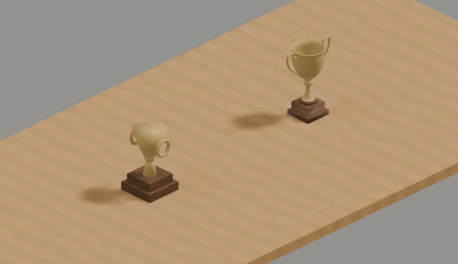

# Meshy props

What a Meshy-generated mesh is worth as an office prop, what it costs, and the one trap in bringing it into a scripted scene. The decision (props only, never the figure; the mesh and a prompt sidecar in `packages/web/art/office/meshes/`) is [ADR 755](../decisions/755-meshy-props.md).

## A preview-tier trophy beats the scripted one, for 5 credits and 20 seconds (2026-10-28; falsify: re-run the trial — the text-to-3d preview of a desk trophy at polycount 3000 — and compare the two in one still under the day rig) <!-- claim: other -->

One prompt, `meshy-t2.5` preview, smart topology, 3,000 polygons: a 57 KB `.glb` in about 20 s for 5 credits. Re-materialed with the room's own brass and wood and smooth-shaded, it sat beside a trophy built from `scene.py` primitives (boxes, a cylinder cup, torus handles). The Meshy cup has a real flare, a thin waisted stem and handles that follow the bowl; the scripted one reads as stacked primitives. nick's read: it looks "pretty realistic".

Its own textures are not used — the scene owns materials, so a Meshy prop matches the room's light the same way a scripted one does.

## It costs /live and /broadcast nothing but sprite bytes (2026-10-28; falsify: a Meshy prop whose shipped asset is anything other than a WebP sheet under `rendered/assets/`) <!-- claim: other -->

The mesh never ships. It is rendered offline into the same WebP sprite as every other prop, so the viewer blits one image; polygon count does not reach the browser. The only runtime cost is the sprite's bytes against `officeArtBytes`, raised and logged per prop like any other.

## Trap: an imported mesh's origin is not its foot (2026-10-28; falsify: import a Meshy `.glb`, set `location` to the slab top, and see whether the base shows) <!-- claim: other -->

Setting `location` on the imported object put the trophy's origin — mid-height — on the desk, so the wooden base sat under the slab and the cup looked baseless. Seat it by its bounds: subtract the bottom-centre of the world-space vertices from the target point.
